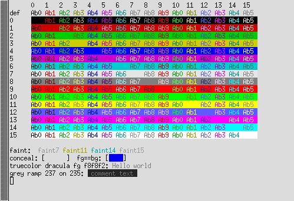

# xterm 412: readable colours, braille-capable default font

Development repository for the mariux64 package `xterm-412-5` (see
`xterm.be0`, as committed in bee-files) and the Hack Braille font.

- **`minimumContrast`.** Text whose WCAG 2 contrast ratio against its
  background is below the resource `minimumContrast` (default 3.0; option
  `-mincontrast`, 1 or less turns it off) is drawn lighter or darker, keeping
  its hue: white on light grey, dark blue on black, yellow on grey, …. Only the
  drawing changes, including the character under the cursor; stored colours,
  screen dumps and colour reports keep what the application chose. Text
  hidden on purpose (same colour index for text and background, concealed)
  is left alone; faint text gets half the margin.
- **VT Options → Enable Minimum Contrast** and the action
  `set-min-contrast(on/off/toggle)` switch it at runtime.
- **Faster colours on deep visuals.** On TrueColor displays reporting more
  than 8 significant bits per channel, xterm asked the X server for every
  colour conversion; over a forwarded display that made colourful and faint
  text 15–25× slower. Pixels are now converted locally.
- **Hack Braille as the default font.** Hack 3.003 plus the braille patterns
  U+2800–U+28FF, which TUIs such as btop use for graphs and which most
  monospace fonts lack (see `screenshots/font-coverage.txt`). All four styles
  are compiled in and registered with fontconfig from memory at startup, at
  12 points. `-fa ''` still selects bitmap fonts.

The same changes exist for VTE and xfce4-terminal (mariux64/xfce4-terminal).

## Layout

| Path | Content |
|---|---|
| `xterm-412/` | xterm sources: the pristine import, then the changes, with history |
| `xterm-412.tgz` | The upstream tarball |
| `xterm.be0`, `*.patch` | The bee file and the patches it applies, as stored in md5repo |
| `hack-braille/` | `mkhackbraille.py`, Hack's licence, README, and `font-hack-braille.be0` (system font package) |
| `screenshots/` | Test scripts, screenshots, font coverage and speed measurements |

`xterm-412-min-contrast.patch` is the diff from the pristine sources to the
contrast commits; `xterm-412-embedded-font.patch` adds the font on top.

## Building

The fonts are not in the repository; unpack the Hack Braille tarball into
the source tree first:

    curl -fsSLO https://beehive.molgen.mpg.de/9d3164696416dac1787155b809fd6787/hack-braille-3.003.tar.gz
    tar xzf hack-braille-3.003.tar.gz -C xterm-412
    mkdir build && cd build
    ../xterm-412/configure --enable-luit --enable-wide-chars
    make
    ./xterm

To remake the fonts from Hack 3.003 (needs Python with fontTools):

    for s in Regular Bold Italic BoldItalic; do
        python3 hack-braille/mkhackbraille.py Hack-$s.ttf HackBraille-$s.ttf
    done

## Licences

xterm: X11/MIT style (see `xterm-412/COPYING`). Hack Braille: as Hack, MIT
and the Bitstream Vera License (`hack-braille/LICENSE.md`). The changes here
are under the licence of the project they change.
